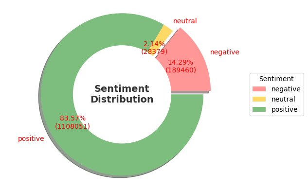
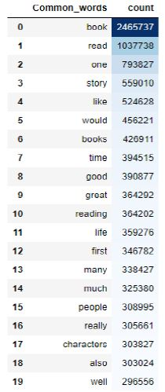
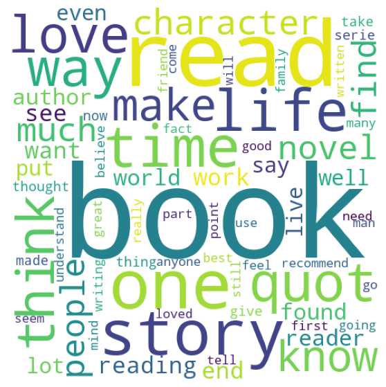

# Amazon Book Reviews Sentiment Analysis

Sentiment analysis of **1.3M+ Amazon book reviews** using Python, Pandas, NLTK, and VADER to uncover how readers feel about books and which words define highly rated reviews.

## Business Problem

Authors, publishers, and marketers need to understand what readers think at scale. This project turns unstructured review text into measurable insights that can guide marketing strategy, product positioning, and content improvement.

## Business Questions

1. What are the most common words in reviews rated above 3 stars?
2. What is the overall sentiment distribution (positive, neutral, negative) across book reviews?

## Key Results

| Sentiment | Reviews | Share |
|---|---|---|
| Positive | ~1.1M | ~83% |
| Negative | ~190K | ~14% |
| Neutral | ~29K | ~2% |

- **Dataset size after cleaning:** 1,325,890 reviews
- **Most frequent words in 3+ star reviews:** *book, read, story, good, great, love, characters, life, time*
- **Insight:** Readers overwhelmingly respond positively, and praise centers on storytelling and characters. This suggests that narrative quality and character development drive satisfaction.
- **Negative reviews (~14%)** are a meaningful segment that publishers and authors can mine for improvement areas.

## Visualizations

### Sentiment Distribution


### Most Frequent Words (3+ Star Reviews)


### Word Cloud


## Tools and Skills

- **Python** (Pandas, NumPy)
- **NLP:** NLTK, VADER, regex text cleaning, tokenization, n-grams, POS tagging
- **Data Visualization:** Matplotlib, Seaborn, WordCloud
- **Data Cleaning, EDA, Text Mining**
- **Jupyter Notebook**

## Dataset

Source: [Amazon Books Reviews on Kaggle](https://www.kaggle.com/datasets/mohamedbakhet/amazon-books-reviews)

| File | Content |
|---|---|
| `Books_rating.csv` | Customer reviews, ratings, and review metadata |
| `books_data.csv` | Book titles, authors, categories, and metadata |

**Features used:** `Title`, `review/score`, `review/text`, `authors`, `categories`, `ratingsCount`

> The raw data is not included due to file size. Download both files from Kaggle and place them in the `data/` folder.

## Methodology

1. **Data Preparation:** Merged reviews with book metadata, removed duplicates and null values, leaving 1,325,890 records.
2. **Text Preprocessing:** Lowercasing, regex removal of URLs, punctuation, special characters and numbers, NLTK stopword removal, tokenization (`Clean_Text` column).
3. **Sentiment Scoring:** VADER compound score per review:

| Sentiment | Compound Score |
|---|---|
| Positive | `>= 0.05` |
| Neutral | `> -0.05 and < 0.05` |
| Negative | `<= -0.05` |

4. **Text Exploration:** Word frequency, word cloud (reviews rated above 3 stars), unigrams, bigrams, trigrams, and POS tags.

## Project Structure

```text
amazon-book-reviews-sentiment-analysis/
├── README.md
├── requirements.txt
├── .gitignore
├── notebooks/
│   └── sentiment_analysis.ipynb
├── data/
│   └── README.md
└── images/
    ├── sentiment_distribution.png
    ├── frequent_words.png
    └── word_cloud.png
```

## How to Run

1. Clone the repository and open the folder:

```bash
git clone https://github.com/<your-username>/amazon-book-reviews-sentiment-analysis.git
cd amazon-book-reviews-sentiment-analysis
```

2. Install dependencies:

```bash
pip install -r requirements.txt
```

3. Download `Books_rating.csv` and `books_data.csv` from [Kaggle](https://www.kaggle.com/datasets/mohamedbakhet/amazon-books-reviews) and place them in the `data/` folder.

4. Launch Jupyter and open the notebook:

```bash
jupyter notebook
```

Open `notebooks/sentiment_analysis.ipynb` and select **Run → Run All Cells**.

> NLTK resources (stopwords, punkt, vader_lexicon, averaged_perceptron_tagger) are downloaded automatically by the notebook's first cell.

## Limitations

- VADER can misread sarcasm, irony, and book-specific vocabulary.
- Reviews with mixed positive and negative points are hard to classify.
- Removing stopwords and punctuation may discard useful context (e.g., negations).
- Labels are lexicon-based and were not validated against manually labeled data.
- Large data volume (1.3M+ rows) demands significant memory and processing time.

## Future Improvements

- Compare VADER with transformer models (BERT/RoBERTa).
- Validate sentiment against star ratings (`review/score`).
- Analyze sentiment by book category/genre.
- Apply topic modeling to negative reviews.
- Build an interactive Power BI/Tableau dashboard.

## References

- Hutto, C. J., & Gilbert, E. (2014). *VADER: A Parsimonious Rule-Based Model for Sentiment Analysis of Social Media Text.* ICWSM.

## Author

**<Your Name>** | [LinkedIn](<your-linkedin-url>) | [GitHub](<your-github-url>) | <your-email>
